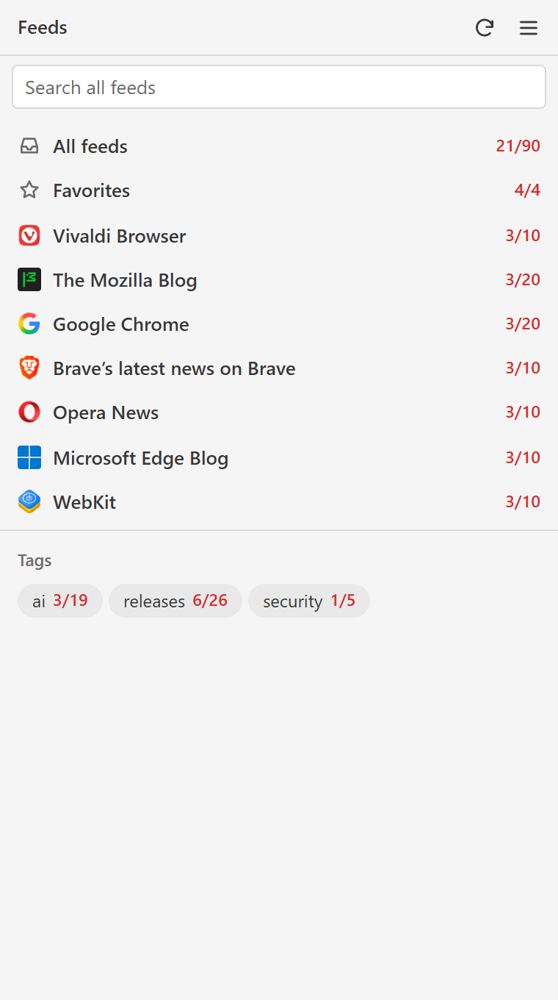
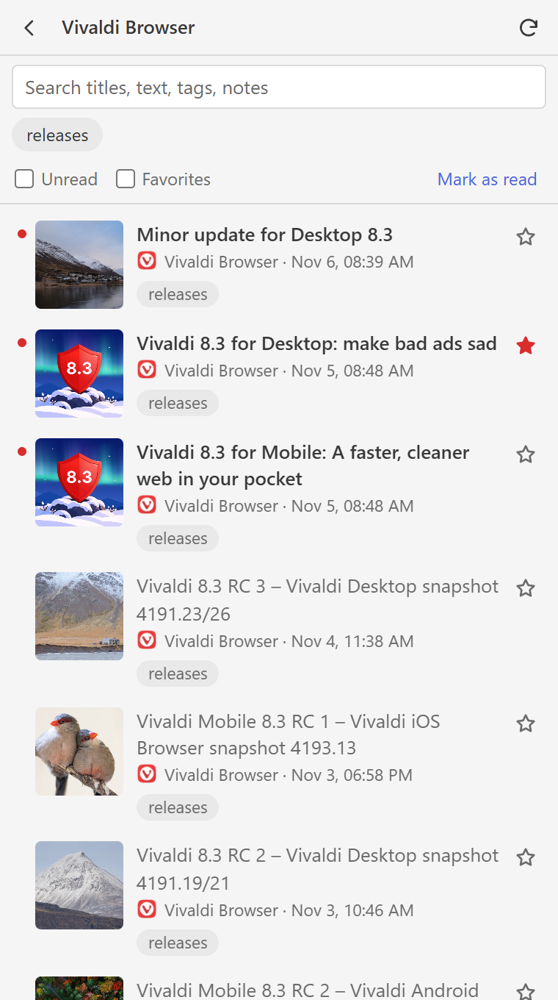
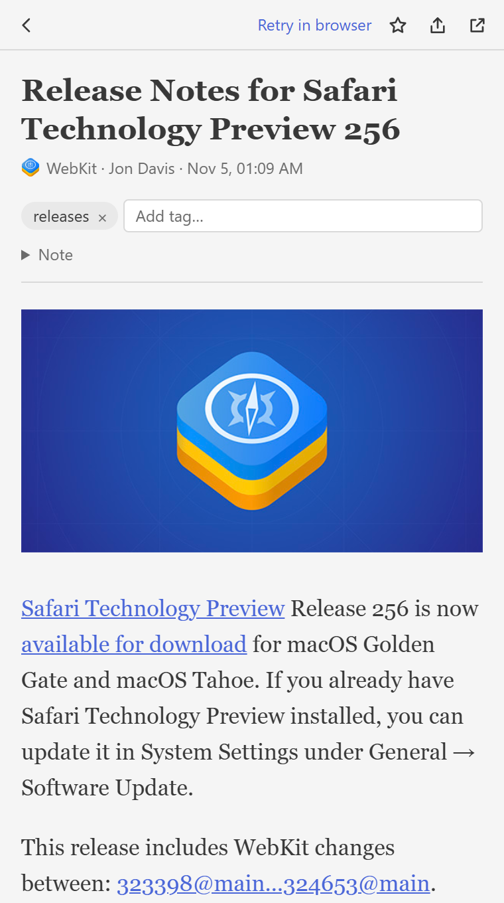
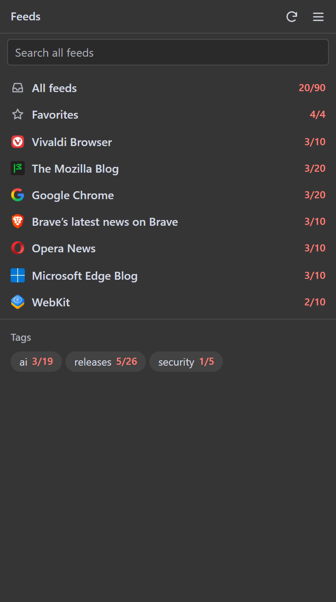
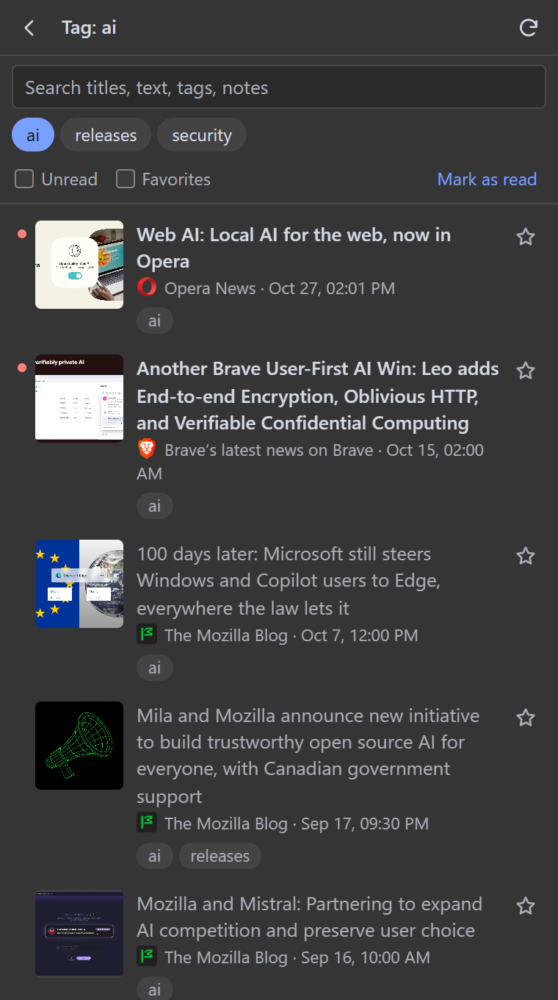
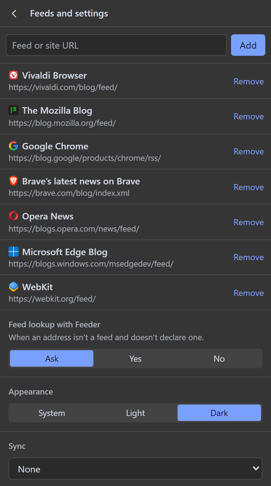

# RSS Reader Panel

A browser extension (Manifest V3) for Chromium browsers with a side panel, such as Chrome and Vivaldi. It aggregates RSS/Atom feeds in the panel and shows each article in reading mode, taken from the original page instead of the feed text.

## Screenshots

| First page | Feed articles | Reading mode |
| --- | --- | --- |
|  |  |  |

| Dark theme | Tag filter | Menu |
| --- | --- | --- |
|  |  |  |

Sample data: the public feeds of various browser blogs. Tags, favorites and read state are for demonstration only. Content, images and trademarks belong to their respective owners.

## Installation

1. Open the browser's extensions page (`chrome://extensions`, `vivaldi://extensions`) and turn on **Developer mode**.
2. Click **Load unpacked** and choose this folder.
3. Click the extension icon in the toolbar to open the panel.

### If the panel does not open in Vivaldi

Vivaldi supports `chrome.sidePanel` only in part. As an alternative, add the page as a web panel:

1. In `vivaldi://extensions`, copy the extension ID.
2. In the sidebar, click **+** (Add web panel) and enter `chrome-extension://<ID>/panel.html`.

## Languages

The interface follows the browser language: English, Spanish, French, German, Italian, Portuguese (Brazil and Portugal), Russian, Polish, Turkish, Japanese, Korean, Chinese (Simplified and Traditional), Arabic and Hindi. Any other language falls back to English. Translations live in `_locales/`.

## Usage

- **First page**: lists **All feeds**, **Favorites**, each feed and, below them, the **Tags** section. Each entry shows its unread and total articles (`3/10`). An entry opens its articles; the back button (or Esc) returns to the previous page. The search box searches all feeds.
- **Menu** (the three lines at the top): add a feed URL or a site address. If the page cannot be reached or does not declare a feed, the panel asks whether to look for it with [Feeder](https://feeder.co/rss-feed-finder): with **Yes** the address (without parameters) is sent to that service, which looks for the site's main feed. This also applies to a feed URL that does not respond. **Don't ask again** saves your answer, which you can change under **Menu → Feed lookup with Feeder** (Ask, Yes, No). Only feeds from the same site are accepted. Addresses without a domain and IP addresses are never sent.
- Feeds refresh when the panel opens, every 30 minutes while it is open, and with the refresh button.
- **Previews**: each article shows an image from the feed or, if the feed has none, from the page (only once the row becomes visible), plus the site icon.
- **Images and videos**: they stay in the reading view. Embedded players are allowed only from known video hosts or URLs that declare themselves players, and they run in an isolated iframe. Below each one is a link to open it in a tab.
- **Search**: looks through titles, authors, feed names, tags, notes and feed text, ignoring accents. Text extracted from pages is not indexed.
- **Favorites**: the star is in both the list and the reading view. The **Favorites** entry on the first page collects them all, including those from removed feeds. The **Favorites** filter in the list shows only those of the open feed or tag.
- **Tags**: in the reading view, type one or more comma-separated tags and press Enter, or pick from the tags already used, suggested as you type. On the first page, each tag opens its articles. In the list, clicking a tag filters the articles and clicking it again removes the filter.
- **Appearance**: under **Menu → Appearance**, choose the System, Light or Dark theme. Colors and sizes are based on Vivaldi's default themes, but an extension cannot read the browser's active theme, so custom browser themes are not followed. The choice applies to this device only.
- **Notes**: open from **Note** in the reading view and save automatically.
- **Share**: copies the link or sends it through the system share menu, WhatsApp, Telegram or email.
- **Removing a feed**: articles with a favorite, tag or note stay; the others are deleted. Refreshes never delete favorites, tags or notes.
- **Retry in browser**: loads the page in a temporary background tab and repeats the extraction. Useful for pages built by JavaScript or blocked by a cookie banner.

## Sync

Turn it on under **Menu → Sync**, on each device. A file named `rss-reader-sync.json` is synced, holding the feed list, read state (last 90 days), favorites, tags and notes. Article text is not uploaded: each device downloads it again from the feeds. If the same annotation changes on two devices, the most recent change wins.

Credentials stay in plain text in the extension's local storage and are not uploaded.

### Dropbox

1. At [dropbox.com/developers/apps](https://www.dropbox.com/developers/apps), create an app with **Scoped** access and **App folder**.
2. In the **Permissions** tab, turn on `files.content.read` and `files.content.write`, then save.
3. In the extension, choose Dropbox, paste the **App key**, open the authorization page and paste the code you receive.

### GitHub

1. Create a **private** repository: the extension refuses public ones.
2. Create a [fine-grained token](https://github.com/settings/personal-access-tokens/new) limited to that repository, with the **Contents: Read and write** permission.
3. In the extension, choose GitHub and enter `owner/repository` and the token.

Each uploaded change becomes a commit. Changes close together are grouped by waiting 30 seconds.

## How extraction works

1. It downloads the page with the browser's cookies, so sites you are signed in to also work.
2. It extracts the article with Mozilla Readability and cleans the HTML with DOMPurify.
3. If it gets little text or the download fails, it shows the longest text available between the page and the feed, with a warning.

## Included libraries

In `vendor/`, each with its own license:

- [Readability.js](https://github.com/mozilla/readability) 0.6.0 (Apache-2.0)
- [DOMPurify](https://github.com/cure53/DOMPurify) 3.4.17 (Apache-2.0 / MPL-2.0)

## License

[MIT](LICENSE), except the libraries in `vendor/`, which keep their own licenses.
